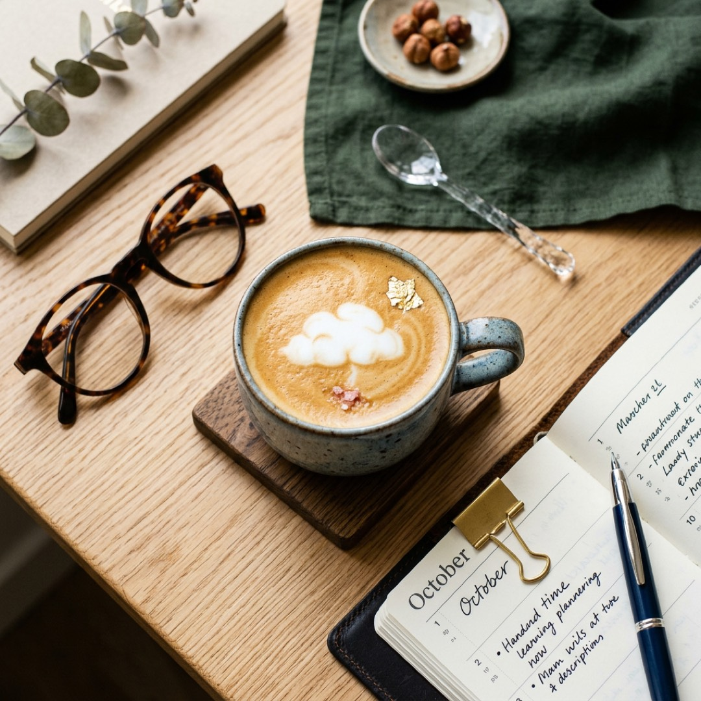
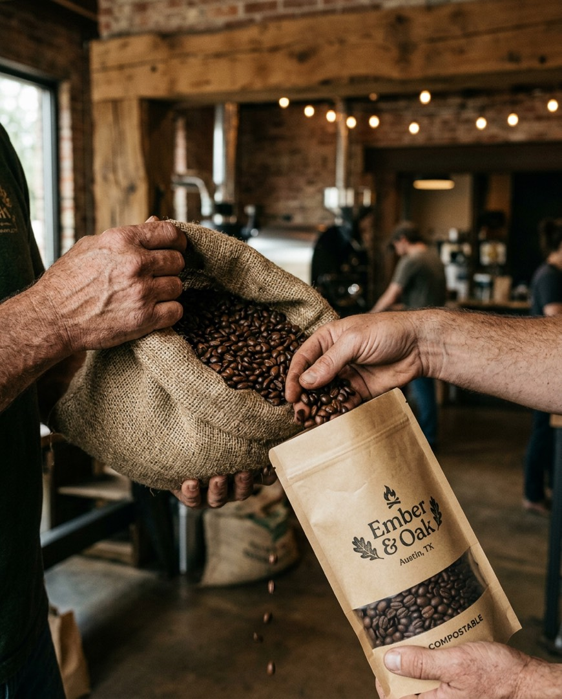

# Designer agent after M2 research and captions

Case `designer_sequence`, run 2026-11-21T16:40:53, text model `gemini-3-flash-preview`, image model `gemini-3.1-flash-image`, commit `a146ad6`.

## Checks

- PASS: final response is not empty (3200 chars)
- PASS: one generate_image call per caption (3 captions) (3 calls)
- PASS: every call passed a supported aspect_ratio (['4:5', '1:1', '4:5'])
- PASS: no raw image bytes in the response (no long base64 run, under 20k chars)
- PASS: image 1: tool returned status success
- PASS: image 1: tool result contains no bytes
- PASS: image 1: gcs_uri points into the images bucket (gs://<BUCKET>/campaign-images/caption1_productivity_pivot-354a4789.png)
- PASS: image 1: object exists in the bucket
- PASS: image 1: object is a real image (PNG/JPEG header parsed) (image/png, 1591073 bytes)
- PASS: image 1: pixel ratio matches 4:5 (±3%) (928x1152 = 0.806)
- PASS: image 1: compressed copy under 300 KB (207 KB)
- PASS: image 1: gcs_uri reported in the response
- PASS: image 2: tool returned status success
- PASS: image 2: tool result contains no bytes
- PASS: image 2: gcs_uri points into the images bucket (gs://<BUCKET>/campaign-images/caption2_swavory_ritual-d87190ed.png)
- PASS: image 2: object exists in the bucket
- PASS: image 2: object is a real image (PNG/JPEG header parsed) (image/png, 1824738 bytes)
- PASS: image 2: pixel ratio matches 1:1 (±3%) (1024x1024 = 1.000)
- PASS: image 2: compressed copy under 300 KB (281 KB)
- PASS: image 2: gcs_uri reported in the response
- PASS: image 3: tool returned status success
- PASS: image 3: tool result contains no bytes
- PASS: image 3: gcs_uri points into the images bucket (gs://<BUCKET>/campaign-images/caption3_story_of_the_batch-9b94ad8a.png)
- PASS: image 3: object exists in the bucket
- PASS: image 3: object is a real image (PNG/JPEG header parsed) (image/png, 1776979 bytes)
- PASS: image 3: pixel ratio matches 4:5 (±3%) (928x1152 = 0.806)
- PASS: image 3: compressed copy under 300 KB (224 KB)
- PASS: image 3: gcs_uri reported in the response

## Images

| # | gcs_uri | ratio asked | pixels | type | seconds | copy |
|---|---|---|---|---|---|---|
| 1 | `gs://<BUCKET>/campaign-images/caption1_productivity_pivot-354a4789.png` | 4:5 | 928x1152 | image/png | 10.4 | _not committed (third-party logos)_ |
| 2 | `gs://<BUCKET>/campaign-images/caption2_swavory_ritual-d87190ed.png` | 1:1 | 1024x1024 | image/png | 10.5 |  |
| 3 | `gs://<BUCKET>/campaign-images/caption3_story_of_the_batch-9b94ad8a.png` | 4:5 | 928x1152 | image/png | 11.5 |  |

## Prompt

```text
Create the visual concepts and generate one image for each of the three captions above.
```

## Tool calls

- `generate_image` {"concept_name": "caption1_productivity_pivot", "aspect_ratio": "4:5", "image_prompt": "Photorealistic, cinematic shot of a high-end 'Premium Alternative Office' workspace inside a sun-drenched Austin roastery. In the foreground, a sleek, minimalist oak wood desk holds a matte black laptop and a premium ceramic mug containing a latte with thick, creamy foam. Beside the mug is a small, elegant bottle of adaptogen drops and a leather-bound planner. The background is softly blurred, showing modern industrial architecture with warm wooden accents and a hint of a lush green plant. Soft, natural sunlight creates a warm glow and gentle shadows. High-resolution, 8k, professional lifestyle photography."}
- `generate_image` {"concept_name": "caption2_swavory_ritual", "aspect_ratio": "1:1", "image_prompt": "A vibrant, high-end 'flat lay' photograph from a 45-degree angle. The center focus is a handcrafted ceramic cup filled with a Miso-Caramel latte, featuring intricate 3D latte art of a small cloud. The latte is garnished with a single, delicate edible gold leaf flake and a pinch of pink sea salt. The cup sits on a textured light oak table next to a pair of stylish tortoiseshell glasses and a high-end open planner with a fountain pen. The lighting is bright and inviting, emphasizing the 'bougie' aesthetic and rich textures of the caramel and wood."}
- `generate_image` {"image_prompt": "A moody, organic documentary-style close-up. Artisanal hands are captured in motion, gently pouring freshly roasted, glossy dark coffee beans from a rustic burlap sack into a minimalist, eco-friendly compostable bag with a subtle 'Ember & Oak' logo. The focus is sharp on the texture of the beans and the fibers of the burlap. The background is a blurred Austin roastery with warm oak beams and soft, ambient lighting. The color palette is earthy and rich, emphasizing transparency and craft. Photorealistic, shallow depth of field.", "aspect_ratio": "4:5", "concept_name": "caption3_story_of_the_batch"}

## Final response

**For Caption 1: "The Productivity Pivot"**

Concept: The Premium Workspace
- **Prompt:** Photorealistic, cinematic shot of a high-end 'Premium Alternative Office' workspace inside a sun-drenched Austin roastery. In the foreground, a sleek, minimalist oak wood desk holds a matte black laptop and a premium ceramic mug containing a latte with thick, creamy foam. Beside the mug is a small, elegant bottle of adaptogen drops and a leather-bound planner. The background is softly blurred, showing modern industrial architecture with warm wooden accents and a hint of a lush green plant. Soft, natural sunlight creates a warm glow and gentle shadows. High-resolution, 8k, professional lifestyle photography.
- **Generated:** gs://<BUCKET>/campaign-images/caption1_productivity_pivot-354a4789.png
- **Style:** Minimalist / Cinematic
- **Colors:** Warm Oak (#B8860B), Deep Charcoal (#333333), Cream (#F5F5DC), Sage Green (#87A96B). Rationale: Blends professional focus with organic comfort.
- **Mood:** Focused, elevated, and serene.
- **Format:** 1080x1350 (4:5)

---

**For Caption 2: "The 'Swavory' Ritual"**

Concept: Aesthetic Gold
- **Prompt:** A vibrant, high-end 'flat lay' photograph from a 45-degree angle. The center focus is a handcrafted ceramic cup filled with a Miso-Caramel latte, featuring intricate 3D latte art of a small cloud. The latte is garnished with a single, delicate edible gold leaf flake and a pinch of pink sea salt. The cup sits on a textured light oak table next to a pair of stylish tortoiseshell glasses and a high-end open planner with a fountain pen. The lighting is bright and inviting, emphasizing the 'bougie' aesthetic and rich textures of the caramel and wood.
- **Generated:** gs://<BUCKET>/campaign-images/caption2_swavory_ritual-d87190ed.png
- **Style:** Vibrant / High-End Lifestyle
- **Colors:** Burnt Orange (#CC5500), Salted Pink (#FADADD), Rich Caramel (#AF6E4D), Gold (#FFD700). Rationale: Highlights the "swavory" flavor profile and social currency.
- **Mood:** Indulgent, aspirational, and creative.
- **Format:** 1080x1080 (1:1)

---

**For Caption 3: "The Story of the Batch"**

Concept: The Oak Foundation
- **Prompt:** A moody, organic documentary-style close-up. Artisanal hands are captured in motion, gently pouring freshly roasted, glossy dark coffee beans from a rustic burlap sack into a minimalist, eco-friendly compostable bag with a subtle 'Ember & Oak' logo. The focus is sharp on the texture of the beans and the fibers of the burlap. The background is a blurred Austin roastery with warm oak beams and soft, ambient lighting. The color palette is earthy and rich, emphasizing transparency and craft. Photorealistic, shallow depth of field.
- **Generated:** gs://<BUCKET>/campaign-images/caption3_story_of_the_batch-9b94ad8a.png
- **Style:** Organic / Moody / Documentary
- **Colors:** Earthy Espresso (#3B2F2F), Burlap Tan (#D2B48C), Deep Forest Green (#013220). Rationale: Communicates sustainability, raw quality, and farm-to-cup origins.
- **Mood:** Authentic, grounded, and sophisticated.
- **Format:** 1080x1350 (4:5)
