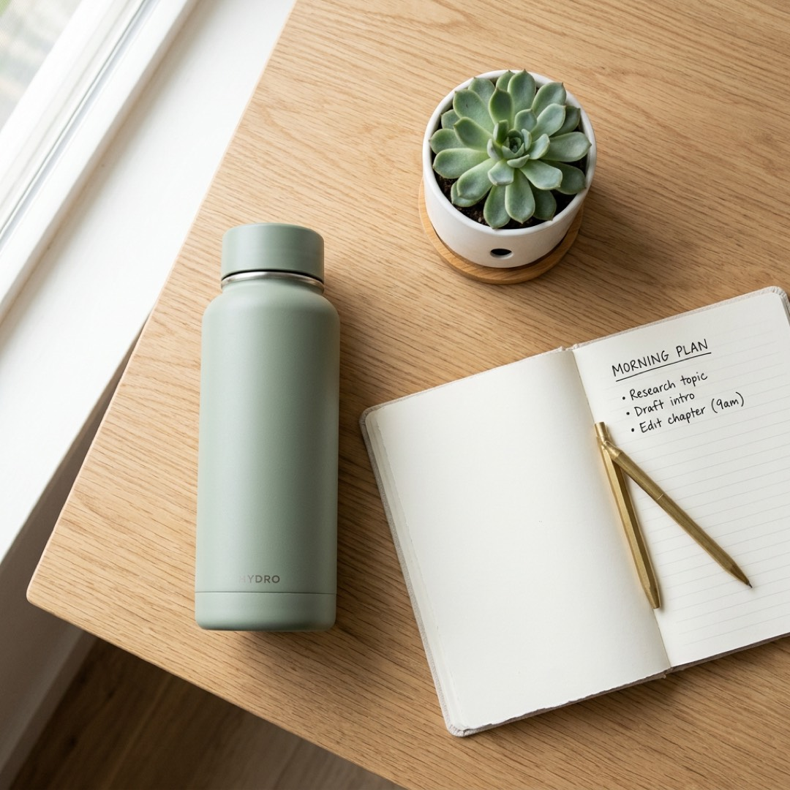

# generate_image called directly, 1:1

Case `tool_square`, run 2026-11-21T16:39:59, text model `gemini-3-flash-preview`, image model `gemini-3.1-flash-image`, commit `a146ad6`.

## Checks

- PASS: tool returned status success
- PASS: tool result contains no bytes
- PASS: gcs_uri points into the images bucket (gs://<BUCKET>/campaign-images/tool_square-59196917.png)
- PASS: object exists in the bucket
- PASS: object is a real image (PNG/JPEG header parsed) (image/png, 1649051 bytes)
- PASS: pixel ratio matches 1:1 (±3%) (1024x1024 = 1.000)
- PASS: compressed copy under 300 KB (227 KB)

## Images

| # | gcs_uri | ratio asked | pixels | type | seconds | copy |
|---|---|---|---|---|---|---|
| 1 | `gs://<BUCKET>/campaign-images/tool_square-59196917.png` | 1:1 | 1024x1024 | image/png | 10.6 |  |

## Prompt

```text
Photorealistic flat lay of a matte sage-green reusable water bottle on a light oak desk next to an open notebook and a small succulent, soft morning window light, minimalist, airy.
```
