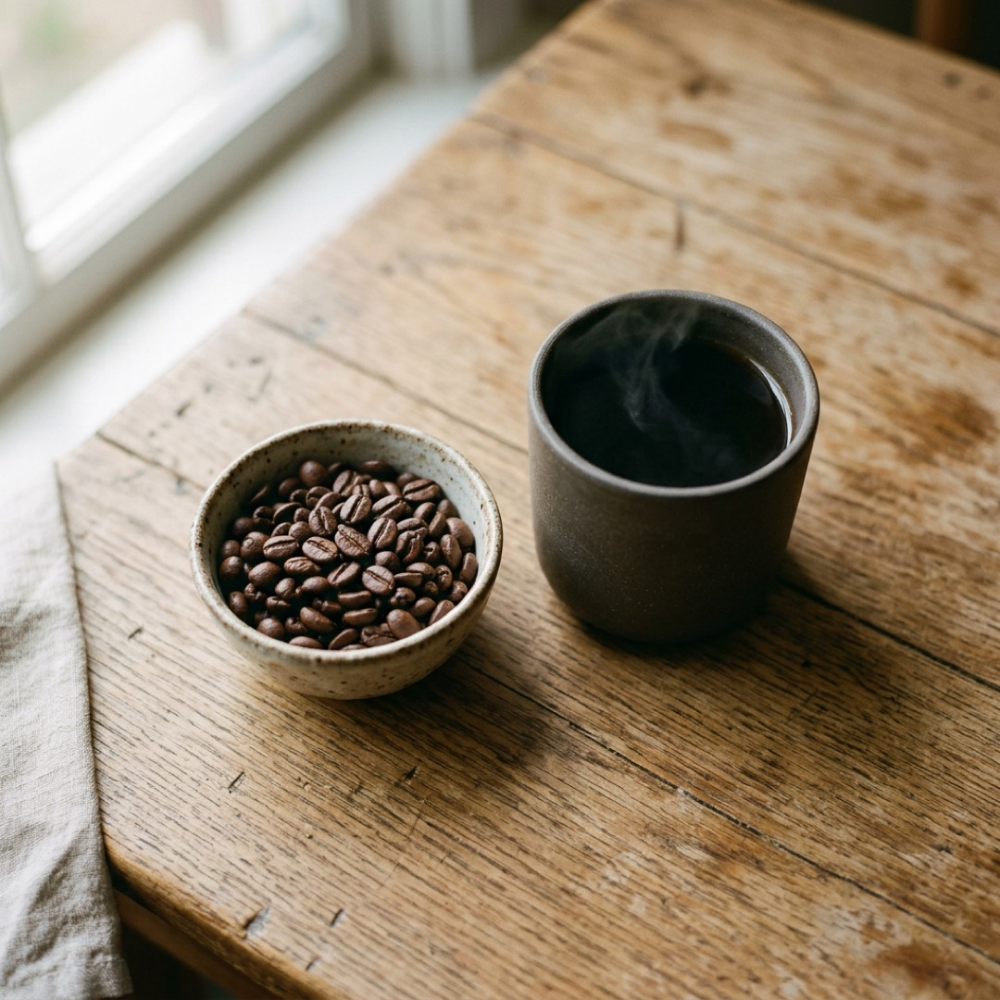

# Milestone 4 verification summary

Generated by `workshop/starter/scripts/verify_m4.py`. Bucket, project ID and number redacted.

| Case | Checks passed | POSTS | VISUALS | All Approved | Overall | Guard corrections | Commit |
|---|---|---|---|---|---|---|---|
| [critic_strong](critic_strong.md): M2 captions + the clean test image | 10/10 | 8/10 APPROVED | 9/10 APPROVED | YES | 8/10 | 0 | `3fbe828` |
| [critic_weak](critic_weak.md): Weak captions + off-brand image with a real logo | 12/12 | 1/10 NEEDS_REVISION | 4/10 NEEDS_REVISION | NO | 1/10 | 0 | `3fbe828` |
| [critic_mixed](critic_mixed.md): M2 captions + 3 images of mixed quality | 11/11 | 9/10 APPROVED | 4/10 NEEDS_REVISION | NO | 4/10 | 0 | `204c7ea` |
| [critic_no_images](critic_no_images.md): M2 captions, no images | 10/10 | 8/10 APPROVED | N/A NOT_REVIEWED | YES | 8/10 | 0 | `3fbe828` |
| [critic_weak_posts_good_visuals](critic_weak_posts_good_visuals.md): Weak captions + the clean test image | 12/12 | 1/10 NEEDS_REVISION | 10/10 APPROVED | NO | 1/10 | 0 | `3fbe828` |
| [critic_strong_2](critic_strong_2.md): Repeat of critic_strong | 10/10 | 9/10 APPROVED | 9/10 APPROVED | YES | 9/10 | 0 | `3fbe828` |
| [critic_weak_2](critic_weak_2.md): Repeat of critic_weak | 11/11 | 2/10 NEEDS_REVISION | 4/10 NEEDS_REVISION | NO | 2/10 | 0 | `5cd9d9f` |

Code commits for these runs: `204c7ea`, `3fbe828`, `5cd9d9f` (per case in the table).

Critic runs used: 11 (plus 0 rejected with 403, not counted). Images generated for M4: 1 (M3 + M4 total: 6). Full history: [run_log.json](run_log.json).

## Clean test image

Simpler-prompt input made to test the Critic's APPROVED path (M4); not Designer agent output. Prompt: "Photorealistic overhead still life: a small ceramic bowl of freshly roasted coffee beans and a matte stone cup of black coffee with a little steam on a warm oak table, soft morning window light, shallow depth of field. No people, no hands, no text, no labels, no logos." Result: 1024x1024, `gs://<BUCKET>/campaign-images/clean_beans_still_life-3c10b922.png`.

## Notes on this evidence

**Inputs.** The Critic is given the M2 captions (`sequence_b`, Ember & Oak) or a deliberately weak
set (typos, no real CTA, generic or off-brand hashtags, a London tea caption), plus `gs://` images.
The M3 images are reused from the bucket. Every M3 image has a real flaw the Critic correctly
rejects (distorted hands, garbled planner text, a real bottle brand's logo), so one extra image,
`clean_beans_still_life`, was generated with the Designer's `generate_image` tool from a **simpler
prompt** (no people, hands, text or logos) purely **to test the APPROVED path**. It is test input,
not Designer agent output. Images generated: 5 in M3 + 1 in M4 = **6 of the 10-image cap**.

**Verdict guard: a tested safety net, 0 corrections in live runs.** `critic/verdict.py` parses the
exact POSTS / VISUALS / OVERALL format and recomputes the fields that follow mechanically from the
`review_image` results (lowest image score, NEEDS_REVISION if any image needs it or a review
failed, NOT_REVIEWED with no images, All Approved, Overall Score). It is covered by offline tests
(`workshop/starter/scripts/test_m4_critic_offline.py`). In every live run on the fixed code the
model's own verdict was already consistent and the guard made **0 corrections**; it is there so
the orchestrator never acts on a wrong aggregate, not because the model needed it here.

**Bug found and fixed: parallel review calls.** In the first `critic_mixed` run the model asked for
three `review_image` calls in one response. ADK runs parallel tool calls concurrently, each with its
own copy of the session state, so appending results to one shared list kept only some of them. The
guard then treated a reviewed image as unreviewed and added a false `[REVIEW_ERROR]` (kept in
[pre-fix/critic_mixed.md](pre-fix/critic_mixed.md)). Commit `204c7ea` stores each review under its own
key (`critic_review:<invocation>:<call>`); the start-of-run reset clears the previous run's keys. An
offline test simulates the parallel merge, and the verification now fails any `[REVIEW_ERROR]` that
is not backed by a failed review.

**Review scores vary between runs.** The same image was scored differently in different runs:
`caption3_story_of_the_batch` got **6** (NEEDS_REVISION, in the earlier `critic_strong`, kept in
[earlier/](earlier/)) and **8** (APPROVED, in `critic_mixed`). `tool_portrait` got 2, 4, 4 and 4; the
clean image got 9, 9 and 10. Clear cases are stable; borderline images can flip across the
approval threshold. For M6 this means a revision loop can flip between pass and fail on an
identical image, so the orchestrator needs a round cap (see `project-docs/plan.md`).

**Logo and text checks.** The image-review prompt asks about real brand logos or trademarks and
garbled or misspelled text. The `tool_portrait` image was flagged for its Hydro Flask logos in every
run, and the `caption2_swavory_ritual` planner text was flagged as garbled ("leanning plannering").

**Commits.** Each case's commit is in the table above. `critic_strong`, `critic_strong_2`,
`critic_weak`, `critic_no_images` and `critic_weak_posts_good_visuals` ran on the final commit
`3fbe828`. `critic_mixed` ran on `204c7ea` (same Critic code; only the verification script changed
after it). `critic_weak_2` ran on `5cd9d9f`, before the parallel-call fix; it reviews a single
image, so the bug could not occur in it. Bucket access worked locally with Part.from_uri; that
proves nothing about Cloud Run, which is checked in M6.
